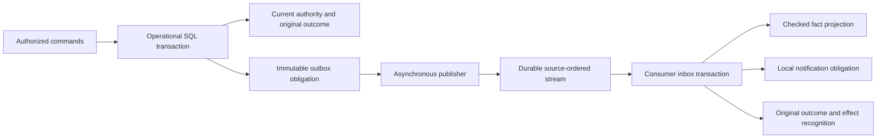

# Event delivery and processing

Phase 22 adds an asynchronous local event runtime over Phase 21's immutable outbox.
The selected transport is a retained PostgreSQL stream. It needs no broker, preserves
originating payloads, and supports controlled real-storage crash tests. Kafka/Redpanda
would add operational machinery without a demonstrated requirement at this scale.
The [completion report](phase-22-completion.md) records measured delivery and limits.



## Run

First stop all API/event writers and run the checksum-pinned offline migration:

```bash
export ROADRUNNER_DATABASE_URL='host=/tmp dbname=roadrunner_local'
cargo +1.99.0 run -p roadrunner-api -- --migrate
```

Migration `0002_events.sql` is additive. It leaves the original operational schema,
world namespace, graph, checkpoint, command semantics and acknowledgement anchor
unchanged. Its separately versioned manifest/checksum is verified at startup. New
binaries require this migration; stop all writers when upgrading. The old operational
record format remains compatible, but running mixed binary versions is unsupported.

Start the API using the [persistence guide](persistence.md), then in another terminal:

```bash
# A protected absolute directory, retained independently of database backups:
install -d -m 700 "$PWD/.roadrunner-state/events-local"
export ROADRUNNER_EVENT_ANCHORS="$PWD/.roadrunner-state/events-local"
RUST_LOG=info cargo +1.99.0 run -p roadrunner-events -- --run local
```

The runtime polls every 100 ms on Tokio, runs PostgreSQL work on blocking workers,
processes one publication and one message per consumer per tick, and skips missed
ticks. Ctrl-C waits for the active tick and closes synchronous clients on a blocking
thread. The same workspace modules can run as local processes; no remote service,
HTTP observation ingestion or new operational authority is introduced.

```bash
# Drain reachable work once; deferred/quarantined messages remain unacknowledged:
cargo +1.99.0 run -p roadrunner-events -- --once local

# Read-only backlog inspection also works while the runtime is active:
cargo +1.99.0 run -p roadrunner-events -- --inspect local

# Stop the runtime before exclusive consumer replay/reconciliation:
cargo +1.99.0 run -p roadrunner-events -- --replay local projection-v1
cargo +1.99.0 run -p roadrunner-events -- --replay local notifications-v1
```

`--inspect` needs only the database URL; writers/replay/reconciliation require the
independent directory. The local driver is explicitly for a trusted database operator.
There is no public event-injection endpoint or remote-source authentication claim.
Production TLS/roles and multi-primary/failover remain outside the supported envelope.

## Categories and identities

The original outbox schema remains version 1:

- `operational.transition`: a successfully validated domain transition/history record
  and its actual committed fact delta.
- `command.completed`: the original terminal command intent/outcome, including noncommit
  or rejected commands; receipt of this event does not establish a business transition.
- `commands.interrupted`: durable recovery evidence for abandoned command reservations.

Integration delivery wraps these records; it cannot replace domain transitions,
physical observations, command authorization or simulation inputs. Timers and receipt
never prove pickup, completion, rider availability or restaurant readiness. Consumers
must not trigger unrestricted automatic re-dispatch from these records. New planning
still uses authorized commands and current certified domain context.

The source is `<namespace>:outbox/v1`. Stream sequence is a positive lossless decimal
string and orders this partition only. Storage/domain revisions may have gaps or many
messages and are not consumer sequence numbers. Each stream record keeps the preceding
event identity. Default message identity is the original event ID; retries preserve it,
sequence and body. Consumer + source + message identity binds a canonical fingerprint.
Changing meaning is a retained `identity_conflict` attempt, never replacement of the
original terminal outcome.

Business-effect recognition is independent. Notifications use the originating event
identity. The projection uses namespace + originating storage revision for complete
fact deltas: multiple history records in one commit carry the same final delta and must
apply it once. Different message identities carrying that effect are recognized without
another projection/notification effect. This is distinct from the domain execution-effect,
command and observation recognition preserved by Phase 21.

## Publication and acknowledgement

A publisher holds a namespace/role session advisory lease and shared migration lock.
Append checks the outstanding original obligation, assigns the next source sequence,
stores the same immutable body/fingerprint/predecessor and attempt evidence atomically.
Transport acknowledgement is a separate durable transaction. Crash after append and
before acknowledgement redelivers that same identity/position/body. Consumer application
may happen before publisher acknowledgement; they are different facts.

Each consumer owns its own stable role lease, pinned kind and implementation semantics.
One transaction checks its receipt head/content before-image, locks the source cursor,
recognizes inbox meaning/order, validates the retained original transport/outbox record,
applies its local effect, records business recognition and the original terminal outcome.
All succeed together or roll back. Delivery ACK is a separate transaction and requires
the exact durable terminal inbox fingerprint. Lost ACK returns the original outcome.

Publisher and each consumer have separate independently fsynced head files and immutable
transaction-receipt ancestry. Before returning success, SQL COMMIT uses synchronous WAL,
then file/rename/parent-directory fsync confirms the new head. An uncertain COMMIT or
anchor failure stops that writer; restore through a fresh exclusive role owner reconciles
verified later receipts. Missing anchors, changed installation/configuration, regressed
heads or changed current content reject restoration. No implicit reconnection occurs.

Keep all operational and event anchors outside database backup rollback. Never delete,
copy or roll them back to authorize a writable clone. Physical writable clones and
cross-host failover are unsupported; local advisory locks do not fence independent
primaries. Retention has no automatic expiry/deletion. Evidence and message recognition
must remain for the authority's lifetime. Notification obligations are local SQL facts;
there is no external send, provider transaction or end-to-end exactly-once claim.

## Consumer effects

`projection-v1` reduces actual before/after fact deltas into `rr_projection`. It checks
the expected previous fact before replacing it. Original initial context values come
from the recorded delta; current traffic/policy cannot substitute for them. The supported
API starts from an empty operational genesis, so entity/execution facts begin absent.
An imported nonempty genesis without complete recorded baseline is unsupported and
quarantines on dependency mismatch. The projection is a debugging/integration read model;
it is never independently writable routing/dispatch authority.

`notifications-v1` inserts an immutable `rr_notifications` obligation for each original
event, atomically with inbox/effect recognition. It does not email, call a provider or
claim remote delivery. Changing consumer names establishes an explicitly new recognition
scope; it is not a way to retry an old effect on an external provider.

## Ordering, poison and reconciliation

Gaps persist `deferred` without advancing the cursor or acknowledging delivery. Retry
once the predecessor commits. Superseded unrecognized positions, changed original
payloads, unsupported semantics and projection dependency mismatches persist quarantine.
Attempts retain identity, payload, fingerprint, outcome and receipt time. A conflicting
retry is retained as an attempt while the original inbox record remains exact.

The runtime stops that consumer's source progression on poison and backs off from one
to thirty seconds. Other consumers keep progressing; there is no global timestamp
last-write-wins. Invalid envelope identities/sequences that cannot form a valid inbox
key reject before reservation; transient SQL faults roll back rather than masquerading
as poison. Backlog/outcome/attempt counts and consumer cursors are available via inspection;
structured logs contain event identities, source positions and result categories, not
customer payloads or credentials.

An authorized local operator can explicitly omit the next quarantined input, supplying
its exact fingerprint, principal and reason:

```bash
export ROADRUNNER_EVENT_OPERATOR='local-operator'
cargo +1.99.0 run -p roadrunner-events -- \
  --skip local notifications-v1 '<message-id>' '<fingerprint>' \
  'Approved omission: unsupported integration semantics'
```

Inspect `rr_inbox`/`rr_event_attempts` in the trusted database to obtain the retained
fingerprint and diagnostic. Skip records immutable reconciliation evidence and a terminal
`skipped` outcome, advances only the next source position, and creates no successful
effect. A projection skip can leave a later before-image unavailable; that later message
also quarantines rather than inventing state. Correct the source dependency or explicitly
resolve the new omission. There is no arbitrary payload rewrite or automatic dead-letter
success. Deferred inputs are retried, not skipped.

## Isolated replay and evidence

Processing replay executes the supported reducer over original recorded attempt order:
recognized duplicates, gaps, conflicts, poison and approved skips. It verifies recorded
outcomes, final inbox meaning, source cursor, effect identities/payloads and projection
against durable facts. Unsupported implementations, missing originals or corrupt evidence
fail narrowly. Replay is a pure in-memory authority and emits no SQL effect, delivery ACK
or external notification. It differs from operational recovery, historical inspection,
optimizer recomputation and simulation replay; no current-data recomputation is implied.

See [fault evidence](evidence/phase-22-runtime.json),
[verification](evidence/phase-22-verification.json) and
[raw measured delivery](../benchmarks/results/phase-22-event-delivery.json).
