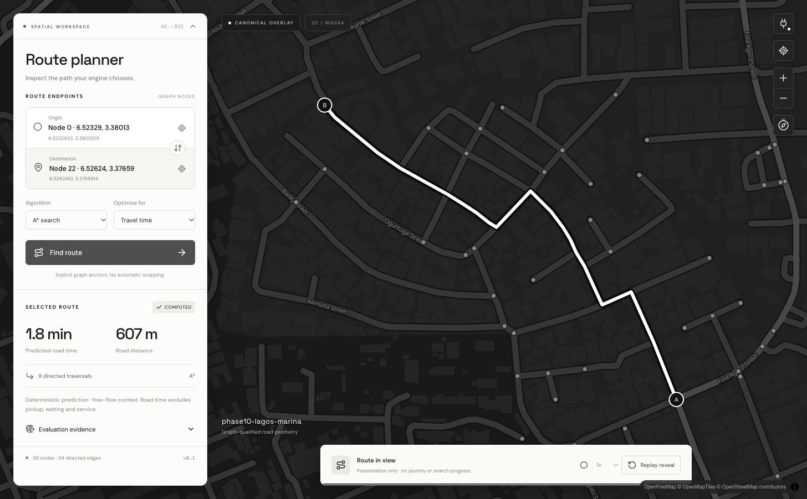
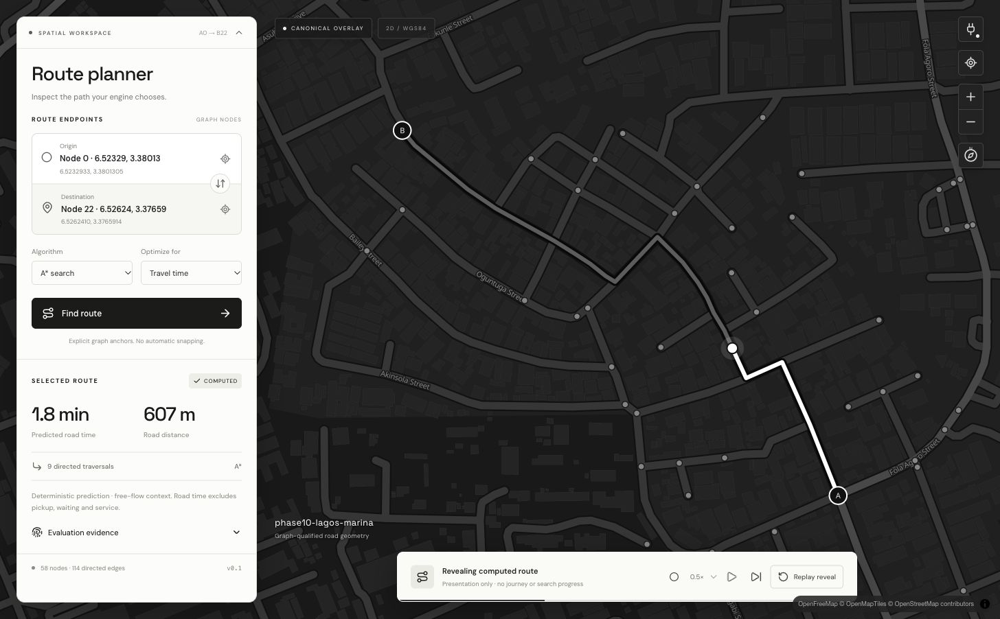
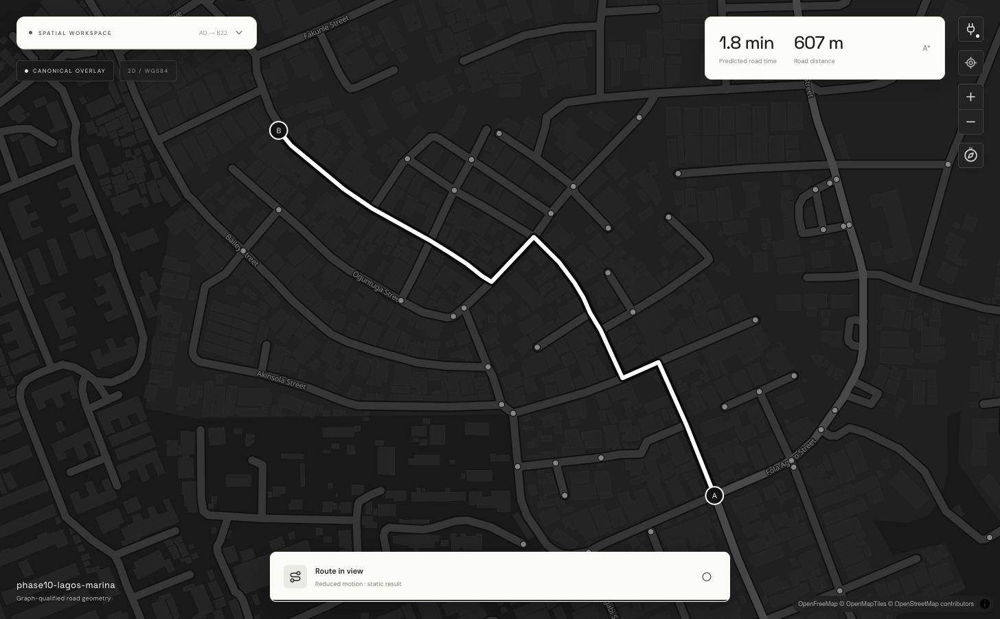
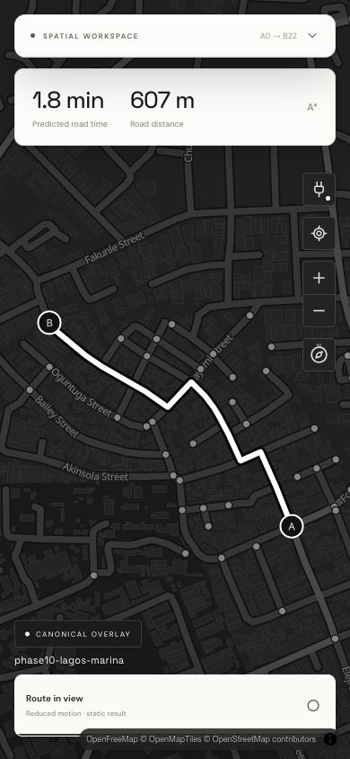

# Phase 27 — Visualization UI Foundation

**Verdict: implemented and verified within the Phase 27 scope.** Phase 28 is not
started. The client consumes the completed Phase 26 producer package and implements
its first real rendering and visual-fidelity gates for one selected route. This is
not a production navigation or fleet-monitoring readiness claim.

## Entry review and plan

Implementation began from `9a014d9`, the actual completed Phase 26 baseline, after
reviewing AGENTS.md, the [Q1–Q49 audit](phase-26-source/audit.md),
[cinematic addendum](phase-26-source/cinematic-addendum.md),
[producer contract](visualization-contract.md), schema, API implementation/tests and
[completion evidence](phase-26-completion.md). The original navigation reference
images were inspected in the primary checkout; their road emphasis/readability
informed the design. Their proprietary imagery and deferred scooter assets were
not copied. The user's latest direction selects black/white, no gradients, a
full-screen map and collapsible floating controls.

The inspected single-route producer exposes exact directed E7 points, occurrence
boundaries, full graph/path/evaluation identities, original evaluation context,
profile/jurisdiction, typed objective, distance and predicted elapsed road seconds.
Its v1 inspection endpoint is authenticated and nonmutating. Cost decompositions
and detailed search traces remain unavailable; guidance, physical movement and
immersive scene data are absent. Arbitrary-coordinate routing/snapping is unsupported.
Node selection needed a small explicit catalog; no routing semantic change was needed.
Node 24.16/npm 11 and the repository Rust toolchain support the chosen Vite/React/
TypeScript/MapLibre environment. MapLibre requires browser WebGL.

The execution plan was: verify interfaces and references; add bounded anchor
selection and the client; implement directed result reveal; run contract/lifecycle
checks and actual browser inspection; refine responsive/visual defects; document
and open a PR. The architecture grill was not restarted.

## Implemented modules

- `web/`: Vite, TypeScript, React, MapLibre GL, lockfile, lint/format/test/build setup.
- `web/src/App.tsx`: collapsible **SPATIAL WORKSPACE** card and icon-only connection control,
  explicit node selectors/map selection, A*/Dijkstra and objective controls,
  truthful result/errors, evidence inspection/download, connection dialog.
- `MapView.tsx`: full-viewport monochrome vector map, canonical route underlay,
  selected prefix/leading highlight, A/B anchors, A=B no-travel, camera framing,
  map controls, contextual provider attribution, rendering/unavailability handling.
- `contracts.ts`: integer-preserving JSON decoding, required-version/authority/
  encoding/objective checks, graph/request/topology/boundary/anchor validation,
  preserved source bytes and original context. Unknown optional additions degrade.
- `geometry.ts` / `useReveal.ts`: renderer-owned Haversine pacing and display-prefix
  derivation, pause/resume/skip/replay/speed, reduced-motion and static fallback.
- `roadrunner-api/src/http.rs`: authenticated 500-node immutable anchor pages.
  No `/v1/state` polling, graph debugger, new optimizer, SQL migration or world mutation.
- API/client tests, frontend CI job, root/API/architecture/run documentation and
  [retained evidence](evidence/phase-27/verification.json).

The map occupies the entire viewport without a navbar; controls, metrics and reveal are floating
overlays. Collapsing/reopening the workspace preserves anchors, result identity,
evidence and reveal progress. A successful mobile request collapses it to expose
the route. Camera fitting accounts for overlays. The small plug control opens the connection modal. Interface fonts and the MapLibre
worker are bundled locally. The external monochrome basemap is contextual only;
its roads never replace or snap the canonical route.

## Verification and actual visual evidence

Fresh final checks:

| Check | Result |
| --- | --- |
| `cargo test --workspace --all-features --locked` | 305 passed, 0 failed, 13 existing opt-in ignored |
| Full workspace/all-target/all-feature Clippy, warnings denied | passed |
| `cargo fmt --all -- --check` | passed |
| `npm test` | 18 passed |
| Frontend ESLint / Prettier check | passed |
| TypeScript + Vite production build | passed; documented large MapLibre chunk warning |
| `git diff --check` | passed |

The opt-in PostgreSQL/event/process suites were not rerun: no persistence, broker,
restoration or operational path changed. The full regular Rust suite was rerun.
No new performance claim is made and no benchmark conclusion is invented.

Browser verification used the actual API and checked-in Lagos semantic-v2 graph
(58 nodes, 114 directed edges), first through Vite development and then the built
assets served by `vite preview` with its inherited local proxy. A 0→22 request
returns **607.312320579204 m**, **105.99551481536915 road seconds**, 38 canonical
points and 9 traversals. The UI's **607 m / 1.8 min** are display rounding of those
source values. Reverse 22→0 was requested and rendered. Actual 0→49 returns
`no_route`; 0→0 remains one point, zero traversals, zero duration/distance, no moving
line or replay. Traffic-aware routing without adopted traffic produces an explicit
`conflict`, “no adopted traffic snapshot.”

The shorter actual producer fixtures 0→35 / 35→0 verify **every** interior directed
point in reverse order, exact duplicated joints, occurrence boundaries, source
metrics/provenance and axis order. Adversarial tests reject wrong versions,
objectives, graph identity, gaps, corrupt boundaries and anchors. Tests preserve
integers above 2^53, exercise repeated out/back shape presentation, cancel stale
requests, distinguish pending computation, reject errors and verify credential
retry without browser storage.

Live reveal verification observed progress 0.160 while paused, unchanged result
text and **zero additional fetches** across replay/pause/resume/skip. A later built
client capture paused at 0.348. Controlled-clock tests additionally cover replacement
evidence, speed, skip, replay, no-travel and reduced motion. Animation never calls
an operational endpoint or changes route evaluation. Floating-panel collapse has
its own noninterference test. The final browser record and screenshots below cover
the revised overlay layout.

Representative desktop (1280×800), mobile (390×844) and tablet (768×1024) layouts
were inspected with no horizontal document overflow. Mobile camera clipping found
during inspection was fixed by refitting on container changes and accounting for
floating controls. Map initialization readiness across development hot reload was
also corrected. An initial basemap returned API-key watermark tiles despite HTTP
200; it was replaced by the documented no-key OpenFreeMap service. Initial worker
resolution and a font export path were corrected and the actual built client was
reopened. Early failed checks were corrected, not suppressed.

T3's preview was used for interaction and noninterference checks. Its captures
mismatched the viewport/duplicated the mobile surface, and later automation returned
`Preview automation select timed out after 15000ms` / `No preview automation host is
available for evaluate`. Chrome through the supported computer-use browser surface
provided the final clean captures and responsive verification. These are actual
screenshots of the running client, not mockups.

## Run and reproduce

Follow [web/README.md](../web/README.md) for exact commands. In brief: start the
trusted-local Rust API with a bearer credential and the checked-in graph, run
`npm ci` and `npm run dev` in `web/`, then connect and select graph anchors.
`npm run build` produces `web/dist`. A general static host needs a same-origin
`/v1` reverse proxy; local `npm run preview` inherits the configured Vite proxy.
Credentials stay in memory or the local server environment and are not bundled.
No public deployment was performed.

## Limits and deferred capabilities

- Selection is exact graph nodes in explicit 500-anchor pages. No geocoder,
  coordinate snapping, connectors or spatially paged edge debugger exists.
- E7 source precision is not physical accuracy. No elevation/grade separation,
  polar or antimeridian-crossing presentation guarantee. Basemap alignment and
  freshness may differ from the pinned graph. Provider tiles/glyphs need network.
- Road ETA is deterministic predicted road time. Base/traffic/turn breakdowns,
  pickup/wait/service, physical speed/location and guidance are not fabricated.
- Reduced motion and routes over 16,000 vertices use static presentation. This
  conservative animation budget is not a measured browser scalability threshold.
  Single-route fixture rendering was inspected; no fleet/multi-route performance
  claim or universal frame-rate guarantee is made.
- The main JS bundle is about 1.38 MB minified / 0.39 MB gzip, plus worker and fonts;
  Vite warns about its size. Later measured payload tuning is still useful.
- The client is a local engineering workspace, not a production identity,
  tenant-isolation, deployment or offline tile-cache solution. WebGL/context-loss
  and basemap error handling exist; exhaustive cross-device GPU/network-fault
  testing is not claimed.
- Full alternatives, graph/search tracing, scooter motion, fleet/dispatch/radial
  selection, historical replay/seek, live subscriptions, immersive 3D and asset
  pipelines remain deferred to their authorized phases/producers.

## Completion and Phase 28 readiness

**Phase 27 is complete for the authorized foundation:** real route requests,
checked directed curves, map/anchors/selected route/metrics, usable failures,
responsive floating overlays, replayable result reveal, reduced motion, real
rendered inspection/refinement, tests/build and documentation are present.

**Phase 28 is ready for a separately authorized implementation.** Phase 26 already
provides selected alternative members, identities, rank, diversity and termination
semantics. The current client intentionally accepts one single-route response;
Phase 28 must add an explicit alternatives adapter and comparison semantics,
including truncated/budget outcomes and per-member provenance, before displaying
multiple routes. No Phase 28 functionality has been started.
