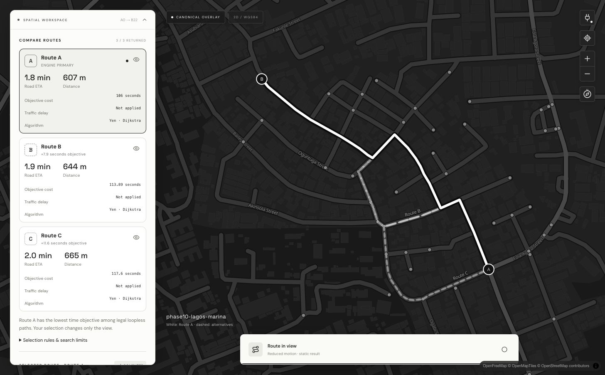

# Phase 28 — Alternative Route Comparison UI

**Verdict: implemented and verified within the original Phase 28 scope.** Phase 29
is not started. This is a local route-comparison engineering interface, not a
production navigation, fleet or graph-search readiness claim.

## Entry review and implementation

Work began from `08cf487b`, the accepted Phase 27 merge. AGENTS.md, the approved
[Q1–Q49 audit](phase-26-source/audit.md), [product-experience addendum](phase-26-source/cinematic-addendum.md),
[portable producer contract](visualization-contract.md), actual Yen implementation,
API capture/export code, conformance tests and the accepted UI were inspected.
The architecture grill was not reopened. Existing React/TypeScript/MapLibre/Vite
versions and the approved black/white, full-screen-map design remain compatible.

The actual endpoint already supplies ranked diverse legal loopless routes, exact
directed E7 occurrence geometry, immutable graph/path/evaluation/member/set identity,
original evaluator/access/departure/traffic context, objective units, predicted road
time, overlap policy and bounded termination/work summaries. Alternative enumeration
uses Yen with Dijkstra internally; A* is rejected by this endpoint. Zero or fewer
alternatives and budget-limited coverage cannot be represented as invented success.

Per-segment objective weights and traffic factors were absent from Phase 26's
portable evidence. The small optional `segment_inspection` extension now evaluates
**returned occurrences only**, through the **same captured static inputs** in the
same request. Sums are checked against the result before export. It adds no search,
optimizer, mutation, global graph export or retained search-event history. Portable
route evidence/IDs and the unavailable original cost-breakdown marker are unchanged.
The [extension specification](visualization-contract.md#phase-28-selected-path-inspection-extension)
records limits, provenance, units, optional-version behavior and delay semantics.
This resolved the Phase 28 inspection prerequisite without an architecture blocker.

Implemented files/modules:

- `web/src/ComparisonPanel.tsx`: A–E cards, source distance/road ETA/cost/unit/algorithm,
  applicable traffic delay, primary-versus-view distinction, objective deltas,
  diversity/termination explanations, bounded traversal inspector and editable index.
- `App.tsx`: single/comparison modes, immutable result retention, independent selection/
  visibility/occurrence state, stale-response invalidation, original-envelope download,
  mobile switches and preserved presentation-only reveal/replay.
- `MapView.tsx`: multiple exact directed paths, selected white reveal, gray alternative
  dash patterns, labels on exclusive physical segments, single topmost hit resolution,
  directed occurrence highlight and bounded responsive camera padding.
- `contracts.ts`: strict required alternative version/scope/provenance/rank/member/
  geometry checks, exact integer counters, optional inspection reconciliation/degradation.
- `styles.css`: cohesive light floating comparison cards, responsive overlays and
  accessible contrast/focus states. No navbar or gradients introduced.
- `crates/roadrunner-api/src/routing/inspection.rs` and `routing.rs`: optional selected
  path static evaluation, behind the existing read/admission/worker/geometry/byte limits.
- Producer/client tests and actual-engine fixtures; root, web, API, architecture,
  visualization-contract and this completion documentation.

The planned execution was inspection, bounded comparison/inspection implementation,
contract tests, actual browser interaction/rendering refinement, documentation and PR.
No routing, dispatch, graph topology, legality, ranking or overlap semantics changed.

## Verification and retained visual evidence

| Check | Result |
| --- | --- |
| `cargo test --workspace --all-features --locked` | 306 passed, 0 failed, 13 existing opt-in tests ignored |
| `cargo clippy --workspace --all-targets --all-features --locked -- -D warnings` | Passed |
| `cargo fmt --all -- --check` | Passed |
| `cd web && npm test` | 25 passed |
| `npm run lint` / `npm run format:check` | Passed |
| `npm run build` | Passed; existing large-bundle warning remains |
| Actual production-bundle browser QA | Desktop, 390×844 mobile, 768×1024 tablet |

See [verification manifest](evidence/phase-28/verification.json), retained command logs,
[browser QA record](evidence/phase-28/browser.json), and actual producer captures in
`web/tests/alternatives*.json`. Test mutations for budget/unknown versions are explicitly
adversarial fixtures; the tiny live graph was not claimed to produce budget truncation.
The 13 ignored tests require disposable PostgreSQL/broker/process infrastructure and
were not rerun explicitly for this presentation/read-only export change.

The real Rust API ran with the checked-in Phase 10 Lagos Marina graph. The built
Vite app was opened and exercised, not merely built. Native preview snapshots timed
out twice with `Preview snapshot failed: Preview automation snapshot timed out after
15000ms.` Browser QA therefore used the available Chrome-control fallback.

- **0→22:** three actual travel-time alternatives; cards, primary, selection and
  visibility matched source evidence. Card and map selection changed the white path.
- **22→0:** three distance alternatives; meters stayed objective units, direction and
  curves reversed correctly, and the primary explanation said distance rather than fastest.
- **0→49:** explicit `no_route`, with no successful selected path or stale metrics.
- **0→0:** one no-travel member, exhausted enumeration, zero traversals, static point
  presentation and no replayable moving line.
- **Traffic:** a disposable local API adopted 2× on edges 53/72/80/94 for QA. Actual
  returned objectives were 113.89, 117.60 and 138.62 seconds (rounded here); the third
  path had 27.19 seconds of same-path delay. Edge 53 showed 8.4855 base seconds,
  16.9710 evaluated seconds and factor 2×. The UI did not adopt/edit traffic. The local
  API was restored to a normal overlay afterward. Already displayed identity/weights
  remained pinned across that server context change.
- **Reveal:** actual replay, pause (retained progress 0.077), selected-member replacement,
  skip and reduced-motion static equivalence were inspected. Unit lifecycle/client
  tests verify no extra routing requests across replay, selection, visibility, segment
  inspection and collapse. Producer tests verify operational noninterference.
- **Interaction:** map traversal picking opened the exact directed occurrence; number
  editing and next/previous worked; collapsed mobile switches preserved evidence;
  the unobscured plug icon still opened the connection modal.
- **Download:** the completed browser download retained all three original members,
  result-set identity, exact geometry and objectives. Its original bytes are retained
  in [browser-source.json](evidence/phase-28/browser-source.json).

Visual QA found and fixed card contrast, card-result scrolling, mobile control overlap,
multiple delegated map-hit handling, number-input editing, labels on shared selected
geometry, and transient resize padding. Screenshots were captured after refinement.
Contextual basemap content is external presentation data; the canonical route always
comes from Roadrunner. Screenshot labels/roads are not invented engine attributes.

[Mobile comparison](evidence/phase-28/mobile-comparison.png) ·
[Tablet comparison](evidence/phase-28/tablet-comparison.png) ·
[Reverse curved occurrence](evidence/phase-28/segment-reverse.png) ·
[Actual traffic factor](evidence/phase-28/traffic-segment.png) ·
[Paused reveal](evidence/phase-28/reveal-paused.png) ·
[Unreachable](evidence/phase-28/unreachable.png) ·
[No travel](evidence/phase-28/no-travel.png).

## Setup and use

Use the existing [API and web development commands](../web/README.md#run).
No additional dependency, service or migration was introduced. Choose **Compare up
to 3 routes**, nodes **0→22**, then Find route. Select cards or visible unselected
map lines; eye controls toggle visibility. Expand segment inspection or click the
white route. Source download retains the entire original alternative envelope.
Single-route A*/Dijkstra remains available. `npm run build` and `npm run preview`
provide the verified production bundle; both use the same configured local API proxy.

## Limitations, deferred scope and Phase 29 readiness

- At most five returned routes; static nonnegative objectives and Yen's original
  diversity/cost/search budgets. A* alternatives, all-candidate history and unrestricted
  legal-walk optimality are unsupported. Truncation is explicitly partial.
- Predicted road time is deterministic, excludes waiting/service, and is not physical
  travel or learned ETA. Delay is relative to the same path; nontraffic inputs are N/A.
- Older/unknown optional segment exports remain usable with unavailable diagnostics.
  No fabricated per-edge costs, traffic or search traces fill those gaps.
- Exact graph-node anchors only; no geocoder, arbitrary-coordinate snapping or guidance.
  WebGL/network-dependent contextual basemap, existing polar/seam limits and static
  reveal fallback above 16,000 selected-route points remain. No large-network frame-rate,
  throughput or cross-browser performance claim is made; the MapLibre bundle warning remains.
- Fully coincident route sections are inherently shared; cards are the unambiguous
  selection control. Labels only appear on exclusive sections with adequate space.
- Fleet/dispatch, scooter simulation, historical timeline/replay, immersive 3D and
  detailed search animation are deferred. Phase 29's global graph debugger is not built.

**Phase 29 readiness:** this provides reusable graph-qualified selection and occurrence
inspection. Global graph-edge/road-class inspection and actual ordered search traces
still require their own bounded producer/capability work under Phase 29 authorization.
Existing summaries are not a search replay. Phase 28 is complete; Phase 29 is not begun.
