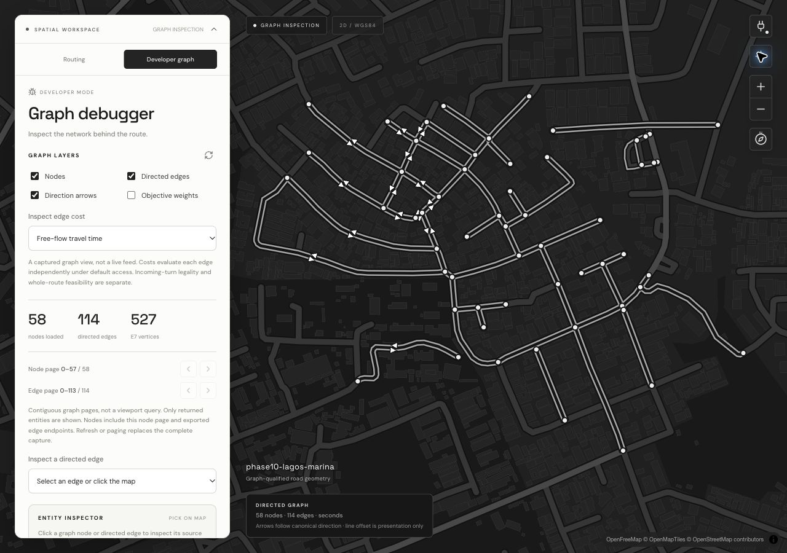

# Phase 29 — Developer Graph Debugger

**Verdict: the supported graph debugger is implemented and verified, with explicit
producer limitations.** Road-class data is unavailable in the existing graph;
optional explored-node membership is also not retained. Neither capability is
claimed implemented by inference. Phase 30 is not started.

## Entry review and scope

Work began from accepted Phase 28 merge `d201fae2`, after reading AGENTS.md,
the approved [Q1–Q49 audit](phase-26-source/audit.md), [product addendum](phase-26-source/cinematic-addendum.md),
[portable evidence contracts](visualization-contract.md), actual frozen graph/cost/
provenance structures, API admission/authentication, existing UI and conformance tests.
No architecture grill was restarted. React/TypeScript/MapLibre/Vite and the existing
Rust toolchain remain compatible; no dependency, migration or hosted service was added.
The accepted black/white, full-screen-map, collapsible-floating-workspace design remains.

The original roadmap requires nodes, directed edges, direction, weights, road class,
traffic multipliers and selected-edge distance/base/current costs. Actual graph
structures support all of these except **road class**. Both the frozen graph and
compiled provenance sidecar omit it, as documented in audit §10. It is explicitly
unavailable in API capabilities and inspection; basemap classifications/default speeds
are never substituted. A verified graph-qualified source enrichment is a separate
producer prerequisite for enabling that required data field. No graph artifact,
identity, routing policy or source pipeline was silently rewritten to fill the gap.

The optional explored-node overlay likewise lacks retained membership or ordered
search events. It is disabled with a reason. Actual last-route search summaries are
shown with precise expanded-state semantics, original evaluation and context. Final
paths do not become search traces or unique-node counts. Detailed search capture,
vehicle movement, fleets and historical playback remain outside this implementation.

The execution plan was: inspect capabilities; add bounded graph export/developer mode;
test source/consumer invariants; inspect actual rendered interactions and responsive
layouts; fix issues; document and open a PR. Unsupported source requirements were
reported during implementation rather than filled with fictional diagnostics.

## Implemented modules

- `roadrunner-api/src/graph_debug.rs`: graph-qualified, independently versioned page
  export; exact E7 nodes/directed curves; default-access static edge evaluation;
  adopted traffic versus applied traffic distinction; null forbidden/unavailable
  costs; explicit capability limits; graph-view content identity.
- `roadrunner-api/src/http.rs` / `lib.rs`: authenticated GET endpoint, existing health/
  worker/export admission, blocking geometry/encoding and bounded retained response
  body; OpenAPI registration. The endpoint count/conformance test now includes it.
- `web/src/graphContracts.ts`: strict version/identity/page/coverage/topology/point/
  unit/cost/context/availability validation; source bytes retained; renderer limits.
- `useGraphDebugger.ts`: abortable page capture, exact previous/next cursor history,
  replacement semantics, independent graph selection/layers/objective and error/retry.
- `GraphPanel.tsx`: layer/cost controls, bounded coverage, node/edge inspectors,
  source evidence/download and honest capability/search-summary inspection.
- `App.tsx`: sticky Routing/Developer controls within SPATIAL WORKSPACE; original
  routed result retained independently; graph picks cannot set route anchors.
- `MapView.tsx`: exact source overlays, offset directed lines, local direction graphics,
  weights, selected entities, capture-qualified picking, explicit selected-entity focus,
  page fitting, hidden stale/error layers and responsive overlay framing.
- `styles.css`, producer/client tests and real captured fixtures; root, web, architecture,
  API and [graph debugger contract](graph-debugger.md) documentation.

Geometry/node IDs, topology, routing, turn restrictions, cost algorithms, optimizer
ranking, dispatch and execution semantics remain unchanged. Static graph costs are
**standalone default-access edge evaluations**, not incoming-maneuver or route legality.
Graph refresh never rewrites the original routed result or changes engine state.

## Verification

| Check | Result |
| --- | --- |
| `cargo test --workspace --all-features --locked` | 312 passed, 0 failed, 13 existing opt-in tests ignored |
| `cargo clippy --workspace --all-targets --all-features --locked -- -D warnings` | Passed |
| `cargo fmt --all -- --check` | Passed |
| `cd web && npm test` | 33 passed |
| Client formatting / ESLint / production build | Passed; existing bundle-size warning remains |
| Actual browser rendering and interactions | Built app + real engine, desktop/mobile/tablet |

[Machine-readable evidence](evidence/phase-29/verification.json),
[browser record](evidence/phase-29/browser.json), retained command logs and actual
`web/tests/graph-*.json` captures support these results. The 13 ignored tests require
opt-in disposable infrastructure; those external suites were not explicitly rerun
for this read-only view/presentation change. No large-network performance claim follows.

Producer checks independently assert curved forward/reverse geometry, isolated nodes,
standalone versus traffic cost parity with an actual route, null unavailable/forbidden
values, exact graph guards, unknown/invalid queries, read-only credentials, noninterference,
500-node/200-edge limits, endpoint unions, point-budget edge-boundary paging, oversized
single-edge rejection, saturation and response-body admission lifetime. Existing global
OpenAPI and route/alternative regression checks also pass.

Client checks use actual producer captures, adversarial malformed/version/context cases,
source-preserving reverse geometry, unavailable inputs, and explicit synthetic transport
pagination to test replacement/cursor/selection behavior. Stale captures abort, source
versions reject, and developer interaction leaves routed evidence/anchor selection intact.
Synthetic UI pages are not claimed as an actual large-network engine run.

## Actual rendered QA and refinements

The production build ran against the real local API with the checked-in Phase 10
Lagos Marina artifact: **58 nodes, 114 directed edges, 527 directed E7 vertices**.
Native preview snapshots failed twice with `Preview snapshot failed: Preview automation
snapshot timed out after 15000ms.` Actual Chrome browser control was used afterward.

Verified interactions include:

- Global node/edge overlays, locally authored direction arrows and source-unit weights;
  visibility changes retain the same capture and never issue routing requests.
- Node 23 picking and opposite directed edges 55 (23→26) / 58 (26→23), with distinct
  selection and exact source metrics. Crossing lines never create connectivity.
- Reverse curved edge 3 (0→9), 68.3474 meters, 12.3025 base seconds. A real disposable
  2× traffic snapshot produced 24.6050 evaluated seconds; distance objective instead
  showed 68.3474 meters while still disclosing the adopted factor separately.
- Explicit selected-entity focus and page fit; ordinary picks/layer toggles retain camera
  placement. Node/edge selection is presentation-only and capture-qualified.
- Curved one-way edge 105 (51→52), seven canonical vertices, 65.4848 meters and 11.7873
  base seconds. Mobile focus showed its directed curve and neighboring actual graph.
- Last routed Dijkstra and A* summaries (23 and 5 expanded search states for 0→35 in this
  fixture), incoming-edge state mode and original counter semantics; explored-node
  overlay remains unavailable. No search sequence or membership was fabricated.
- A stopped disposable API left the existing capture pinned until explicit refresh;
  refresh showed unavailable/retry and cleared stale inspection. Restart/retry restored
  graph geometry while traffic-aware costs remained unavailable without an adopted
  snapshot. Original routed evaluation remained unchanged through debugger operations.
- Desktop, 390×844 mobile and 768×1024 tablet interactions and framing, collapsed-card
  focus, mobile inspection, plug connection control and return to retained Routing state.

Browser inspection drove fixes to direction-glyph visibility, inspector density,
shared header/legend spacing, conservative camera fitting around overlays, selection
framing behavior, capture-qualified map hits and stale-layer hiding. Final browser
logs caught an intermittent invalid camera fit; startup readiness, direct point focus
and finite-camera fallback now prevent an invalid center during responsive transitions. A temporary test
failure also caught the expected OpenAPI path-count update. A slow DOM-role paging
query was replaced with an equivalent targeted control assertion to avoid timing noise;
all final tests pass. No screenshots are substituted mockups or external navigation assets.

[Focused node](evidence/phase-29/node-focus.png) ·
[Focused reverse edge](evidence/phase-29/focused-reverse-edge.png) ·
[Actual traffic factor](evidence/phase-29/traffic-edge.png) ·
[Weight overlay](evidence/phase-29/weight-overlay.png) ·
[Mobile one-way curve](evidence/phase-29/mobile-one-way.png) ·
[Mobile inspector](evidence/phase-29/mobile-inspector.png) ·
[Tablet](evidence/phase-29/tablet-graph.png) ·
[Unavailable engine](evidence/phase-29/engine-unavailable.png) ·
[Unavailable traffic](evidence/phase-29/traffic-unavailable.png) ·
[Search summary](evidence/phase-29/search-summary.png).

## Setup, limits and Phase 30 boundary

Use the [existing setup/run instructions](../web/README.md#run), then choose
**Developer graph**. No new configuration is needed. The [wire/interaction guide](graph-debugger.md)
documents capture identities, units, 500-node-plus-endpoint/200-edge/20,000-vertex/4-MiB
limits, static evaluation semantics and errors. Pages replace captures; they are not
viewport queries. Large adopted traffic snapshots retain the API's existing clone
cost, so output bounds are not a graph-independent latency/memory guarantee.

Road class is a genuine unsupported data requirement and remains explicitly unavailable.
Optional explored-node membership and detailed trace animation are also unavailable.
Coincident edges and scale/collision-limited labels remain selectable through the
explicit edge picker. WebGL, external contextual tiles/fonts and existing polar/seam
presentation limits apply. Canonical geometry/distance is never supplied by the basemap.

Phase 30 has not begun: there is no rider/scooter movement, fleet visualization,
dispatch animation, operational playback, 3D environment or new movement producer.
The graph/route inspection foundation is reusable, but delivery visualization still
requires its own actual simulation/execution evidence and separately qualified movement
presentation under the approved contracts. This report does not claim those capabilities.
