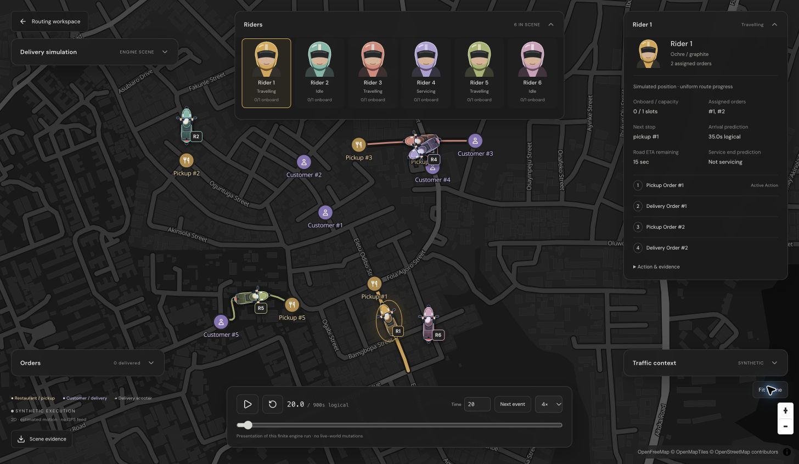
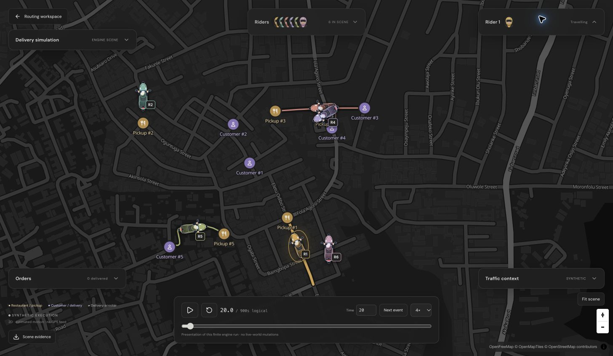
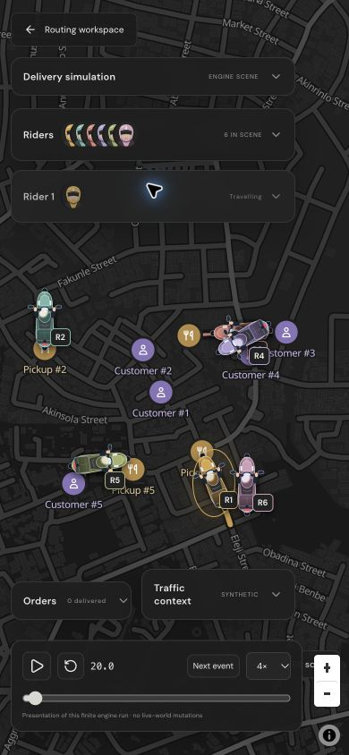

# Phase 30 completion report

Phase 30 is implemented on `feat/live-delivery-visualization` in the existing checkout;
no worktree was created. Its bounded synthetic-execution acceptance criteria are
satisfied. Phase 30.5 and Phase 31 implementation remain unstarted. The proposed
[30.5 specification](phase-30.5-proposal.md) is recorded in AGENTS.md as proposed only,
following the user's explicit request to add it. PR titles now require Conventional Commits.

## Delivered behavior

A full-screen 2D MapLibre map renders pickup/customer locations, original frozen
active routes and distinct animated overhead delivery scooters. Pickups use gold restaurant glyphs;
customers use lavender person glyphs, with matching labels and legend entries. Independent floating
cards expose setup, helmet-portrait rider selection, selected execution, orders,
traffic and presentation controls. Every card can collapse; fleet summaries retain
overlapping helmet portraits and selected-rider summaries retain that portrait.
The UI uses the routing workspace's monochrome palette, with cosmetic rider-specific
color combinations shared by portraits, scooters and route accents. No sidebar
reserves map area. Up to 32 appearance combinations are supported; identity remains
scene/RiderId rather than color, rank, action generation or DOM order.

The engine retains authority over assignments, custody/load, capacity, stop order,
arrival, waiting, service and completion. The UI exposes applicable active arrival,
remaining road ETA and service-end predictions, original action/route traffic,
originating/current plan revisions, ActionId, generation and accepted effects.
No timer establishes delivery. The full original response is downloadable.

[The detailed producer/motion contract](live-delivery-visualization.md) defines all
interfaces, budgets and limitations. One new protected HTTP endpoint runs existing
simulation semantics with opt-in coherent captures and checked original geometry;
existing live operational state and ordinary simulation artifacts are unchanged.

## Clustering cause and distributed evidence

The old two-rider configuration reuses three graph nodes and sends the second rider
from the first customer's node back toward the first rider's starting area. The
result is expected fixture geometry, not evidence of a routing defect or marker bug.
The actual directions, owner IDs and projected points match frozen execution.

A selectable **Distributed Fleet Demo** now uses six distinct supported graph nodes,
five distinct pickup/customer pairs, declared readiness/service timing and unchanged
Greedy dispatch. It spans multiple components/streets within the bundled graph's
roughly 520 × 670 m footprint. At 20 seconds: riders 1/3/5 travel, rider 4 services,
and 2/6 idle. The engine assigns orders 1+2 to rider 1, then orders 3/4/5 to riders
3/4/5 respectively. These actual outcomes are preserved; no cosmetic reassignment
or position offsets are applied. Five deliveries complete. Neighborhood/city-scale
coverage requires a larger verified graph, which this phase does not fabricate.

The UI's distributed scene identity exactly matches the reproduced source artifact:
`scene-v1:5deb6a6f9776d0a499786b7e47c51c2b5c321d9fcc37be6511a84cc5d8874e9d`.
The demo is enabled only for its exact pinned graph; node selectors apply to the
other presets, and explicit JSON visibly overrides preset inputs.

## Verification

- `cargo fmt --all -- --check`: passed.
- `cargo clippy --workspace --all-targets --locked -- -D warnings`: passed.
- `cargo test --workspace --locked`: **314 passed**, no failed tests.
- Frontend Vitest: **52 passed** across ten files.
- TypeScript/Vite production build, ESLint and Prettier: passed.
- Six actual HTTP source scenarios reproduced exactly; live namespace, revision,
  world, execution, plans and publications stayed unchanged. See
  [reproduction.json](evidence/phase-30/reproduction.json) and the
  [verification script](../scripts/verify_delivery_scene.py).

Checked scenarios include solo pickup/service, two concurrent riders, active road
delay and plan suffix change, synthetic traffic replacement, unfinished horizon and
distributed fleet. Backend tests independently exercise curved/reverse geometry,
concurrent actors, waiting/service, exact frozen path preservation, capability/graph/
resource rejection, empty orders and live-world noninterference. Existing OpenAPI
path-count assertions now include the new endpoint.

Client tests exercise causal pre/post-delay samples, generation/plan independence,
original directed paths, no-travel neutral orientation, accepted custody/service,
completion only after accepted effects, expired predictions without completion,
unsupported geometry/traffic, incompatible graph/direction/version/order rejection,
32 distinct cosmetic combinations, stable marker DOM identity and no per-frame path
uploads. Missing-input tests mutate evidence explicitly as negative fixtures; they
are not represented as backend observations. Reduced-motion tests start paused and
preserve inspection/time selection.

Actual browser inspection used the running Rust API and Vite client. The T3 preview
snapshot timed out twice (`Preview automation snapshot timed out after 15000ms.`),
so verification continued in Chrome through the supported computer-use browser.
Screenshots cover the full-map desktop and mobile layouts, distinct scooter/portrait
appearance, collapsed overlapping portraits, six independent rider identities,
waiting, service, schedule/suffix lineage and actual traffic factors. At 1 second
of the delayed scenario the browser had one marker, action 0/generation 0. At 5 seconds
it still had one marker, action 0/generation 1, originating plan 1/current plan 2.
No duplicate marker was created. At 125 seconds in the traffic scenario, the action
was Servicing, load 0/2, arrival accepted at 50.523 s and service-end prediction 135 s;
fulfillment had not been advanced by the arrival prediction.

The six-rider view was responsive during visual sampling/playback. No quantitative
frame-rate or large-fleet performance claim is made. Immutable paths upload only at
source transitions/selection/context changes; requestAnimationFrame updates existing
markers. The bundle still emits the known MapLibre large-chunk warning (~1.475 MB
main JS minified / 413 kB gzip plus worker). Resource admission limits are in the
contract; this is not a production fleet projection or streaming service.

## Visual evidence

Additional evidence: [delay/suffix](evidence/phase-30/delay-suffix.jpg),
[accepted waiting](evidence/phase-30/distributed-waiting.jpg),
[traffic](evidence/phase-30/traffic-context.jpg),
[service](evidence/phase-30/servicing.jpg).

## Motion and unsupported information

The versioned motion model is causal uniform progress along Haversine polyline
distance with linear interpolation between original E7 vertices. A delay preserves
pre-intervention progress and changes only subsequent remaining progress. Bearing
comes from directed geometry; no-travel/idle uses neutral orientation. Waiting and
service retain the accepted endpoint. Unknown original geometry hides active position
and explains why. Predicted endpoints can remain estimated, never accepted by a timer.
These are simulated positions, not measured GPS, heading or physical speed.

Traffic styling/inspection uses actual current **synthetic static** engine context,
with its full digest and actual normal default. Current road time is explicitly
computed from retained base seconds × supported factor. Coverage is the first bounded
Phase 29 edge page, not city density or a live feed. Original frozen traffic remains
separate from the new current context. Unsupported context disables the overlay.
Turn-cost ledgers, physical vehicle counts/density, observed speeds/GPS/uncertainty,
live scoped subscriptions, mixed-graph historical resolution and physically interacting
ambient vehicles remain unsupported. There are no fabricated cost components.

## Changed interfaces and files

- Simulation: `simulate_scene`, `SceneFrame`, optional `SimulationResult.scene_frames`;
  [engine.rs](../crates/roadrunner-simulation/src/engine.rs),
  [lib.rs](../crates/roadrunner-simulation/src/lib.rs),
  [metrics.rs](../crates/roadrunner-simulation/src/metrics.rs).
- API: `POST /v1/visualization/deliveries`, versioned bounded scene projection;
  [delivery_scene.rs](../crates/roadrunner-api/src/delivery_scene.rs), HTTP registration/
  OpenAPI in `http.rs`, module registration in `lib.rs`, new integration tests and
  updated existing HTTP documentation assertions.
- Client: [DeliveryWorkspace.tsx](../web/src/DeliveryWorkspace.tsx),
  [DeliveryMap.tsx](../web/src/DeliveryMap.tsx),
  [deliveryScene.ts](../web/src/deliveryScene.ts),
  [RiderPortrait.tsx](../web/src/RiderPortrait.tsx),
  [riderVisual.ts](../web/src/riderVisual.ts), original `assets/delivery-scooter.svg`,
  workspace entry in `App.tsx`, shared unchanged map-style export in `MapView.tsx`,
  floating-card/responsive styles in `styles.css`.
- Tests/evidence: six `web/tests/delivery-*.json` real responses, decoder/motion,
  marker-lifecycle, floating-workspace and appearance tests; scenario inputs, fresh
  verification logs, browser proof/screenshots in `docs/evidence/phase-30`;
  `scripts/verify_delivery_scene.py`.
- Documentation: AGENTS.md Phase 30 design/evidence requirements, proposed 30.5 and
  explicit Phase 31 radar criteria; this report, detailed contract, 30.5 proposal,
  API/visualization contracts and web/test/root README links.

No migrations, production traffic feeds, operational routing/planning semantics,
ambient traffic, perspective camera or 3D asset pipeline were introduced. Work stops
at Phase 30. The separately staged 30.5A/B/C proposal supplies prerequisites,
deliverables, acceptance and resource/fidelity limits for later authorization.
